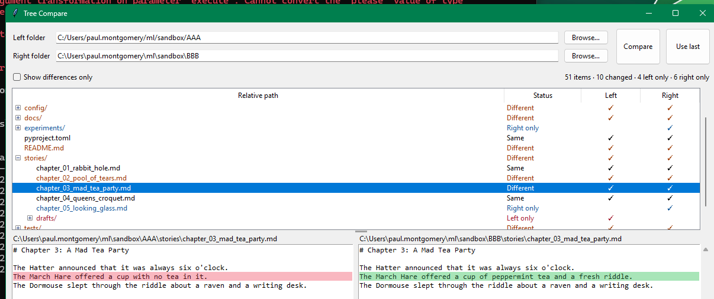

# Tree Compare

## repo
https://github.com/mulefish/directory_tree_compare

## Flask
python server.py 

## screenshot

## powershell
python server.py "C:\path\to\left" "C:\path\to\right" --json

## About 
Edit `treecompareignore` in the app folder to exclude items from both trees. Use one glob per line. A filename pattern such as `*.pyc` matches anywhere; a folder pattern such as `node_modules/` skips that folder and everything below it. A pattern with a path, such as `logs/*.log`, matches relative to the selected folders. Blank lines and lines beginning with `#` are ignored. The file is read again each time you click **Compare**.

Changed lines in the file preview are red on the left and green on the right. The preview scrolls to the first changed line. Line ending differences (CRLF, LF, CR, or a missing final newline) are ignored for text files. The app never changes the compared folders. It does not follow symbolic links. Binary files, text files over 2 MB, and text files over 4,000 lines are compared, but do not get a text preview.

Click **Compare** to save the selected pair of folders locally. Click **Use last** to put that pair back into the two folder fields, including after restarting the app. On Windows, the paths are stored in `%LOCALAPPDATA%\TreeCompare\last_paths.json`.

Run the tests with `python -m unittest -v`.
